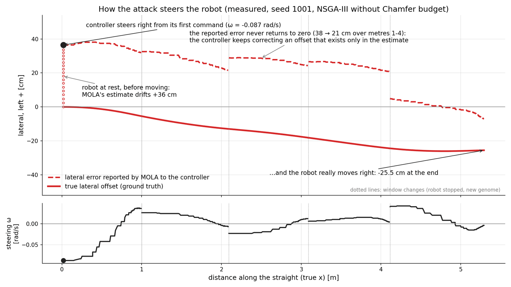
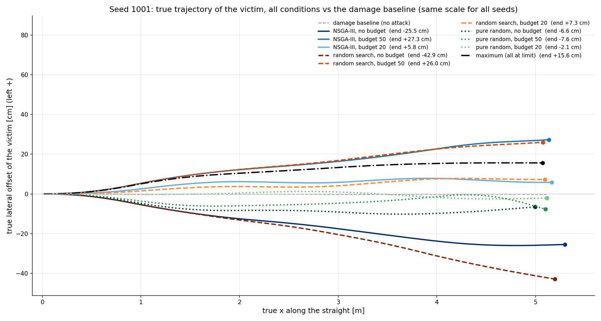
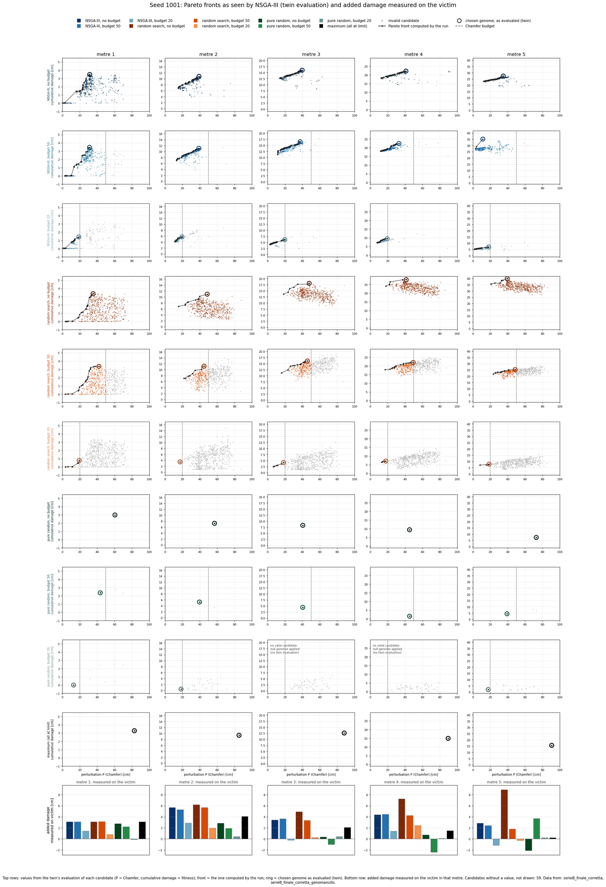

# Multi-Objective Optimization of LiDAR Adversarial Attacks against Robot Localization Using NSGA-III

Master's thesis code, University of Trieste. The project searches for perturbations of the LiDAR
point cloud that push a wheeled robot off its path by corrupting its LiDAR odometry, while
keeping the perturbation small. Everything runs in closed loop: the perturbed cloud reaches
[MOLA](https://github.com/MOLAorg/mola) LiDAR odometry, the odometry estimate drives the robot
controller, and the robot moves in Isaac Sim.

- Robot and scene: NVIDIA Nova Carter (differential drive) with a Hesai XT-32 LiDAR at 10 Hz
  (about 45k points per scan, sensor noise set to zero), warehouse scene in Isaac Sim 6.1.
- Odometry: `mola_lidar_odometry` 3.2.0 on ROS 2 Jazzy, local copies of the MOLA pipeline
  files in `config/mola/`.
- Task: follow a 5 m straight line; the controller steers towards a point 5 m ahead on the
  line using the pose estimated by MOLA.
- Search: NSGA-III (pymoo) over a 17-gene genome with two objectives, damage to be maximised
  and Chamfer distance between clean and perturbed cloud to be minimised; optionally a
  Chamfer budget as a constraint.

## Threat model

The attacker sits between the sensor and the odometry and can only modify the point cloud
(noise per point, dropout, geometric distortion of the scan, ghost points, cluster and edge
shifts, temporal drift of the whole cloud). It knows the robot's own estimate of its pose,
not the true pose, and has no access to MOLA's internals or to the velocity commands.
Perceptibility is measured by the Chamfer distance between the clean and the perturbed cloud.

## Architecture

- **Victim**: the MOLA instance that receives the perturbed clouds and drives the robot.
- **Shadow**: a second MOLA instance fed with the same clouds as the victim; at the end of
  every window its full state is saved to disk.
- **Twin**: a MOLA instance that loads the shadow state and evaluates candidate genomes in
  simulated rollouts that start from the victim's current state. This needs the small patch
  to MOLA in `mola_overlay/` (full-state save and load).
- **Receding horizon**: the path is split into 1 m windows. At the end of each window the
  robot stops, NSGA-III evaluates 32 x 16 = 512 candidates on the twin, the selected genome
  (maximum damage on the Pareto front within the Chamfer budget) is replayed three times on
  the twin and then applied to the victim for the next metre.

Damage is measured against a no-attack baseline (mean of three seeds,
`data/attack/baseline/`): the added damage of a metre is the mean distance of the true path
from the baseline path over that metre minus the distance at its start; `D` is the sum over
the five metres. The noise floor `F` is the larger of two terms: the largest `|D|` of the three
no-attack runs measured against their mean path, and the median spread of `D` over the three
replays of each selected genome.

## Results

Three seeds (1001, 2001, 3001), one run per seed and condition, 5 m straight, 1 m windows.
Each cell gives the final lateral offset of the true path and `D`, both in cm.

| condition | seed 1001 | seed 2001 | seed 3001 |
|---|---|---|---|
| NSGA-III, no budget | -25.51 / 19.47 | -46.21 / 31.87 | +84.83 / 58.24 |
| random search, no budget | -42.94 / 30.37 | -23.74 / 17.21 | -40.53 / 28.11 |
| pure random, no budget | -6.58 / 4.58 | +30.03 / 21.43 | -10.89 / 8.43 |
| NSGA-III, Chamfer <= 20 cm | +5.83 / 4.34 | +12.74 / 8.80 | -12.49 / 8.35 |
| random search, Chamfer <= 20 cm | +7.31 / 5.23 | -8.42 / 5.63 | +9.68 / 6.82 |
| pure random, Chamfer <= 20 cm | -2.13 / 1.09 | -5.65 / 3.22 | +0.74 / 0.80 |
| NSGA-III, Chamfer <= 50 cm | +27.33 / 18.97 | -26.50 / 19.77 | +20.34 / 14.52 |
| random search, Chamfer <= 50 cm | +26.02 / 18.16 | -29.59 / 20.34 | -36.27 / 25.05 |
| pure random, Chamfer <= 50 cm | -7.65 / 4.43 | +13.10 / 9.66 | +0.07 / 1.95 |
| fixed maximum genome | +15.63 / 10.97 | +15.45 / 10.81 | +15.23 / 10.80 |

*Random search* draws 512 genomes per window and uses the same twin evaluation and selection
as NSGA-III. *Pure random* draws one genome at a time and applies the first admissible one
(at most 64 draws; if none is admissible the window is driven with the null genome, which
happened in 2 metres). The *fixed maximum genome* sets every operator to its maximum, with no
search.

- Noise floor: `F` = 0.385 cm, computed on all budgets including Chamfer <= 5 cm (one seed
  only, not shown). `D` is above `F` in every run of the table.
- NSGA-III and random search are **not distinguishable** at any budget: the paired
  differences change sign across seeds and exceed `F`.
- Both searches beat pure random at Chamfer <= 20 cm and <= 50 cm in all three seeds, and
  NSGA-III also without budget. Random search and pure random are not distinguishable
  without budget.
- Admissible candidates under the 20 cm budget: 7056 of 7680 for NSGA-III, 177 of 7680 for
  random search (15 windows per arm).
- Victim odometry: 14 ICP failures out of 8951 victim scans in the 30 runs of the table, no
  scans rejected for low ICP quality. All failures fall in the first clouds after the victim resumes from
  the optimisation pause, with the robot still stopped.
- The +84.83 cm of NSGA-III on seed 3001 is a single run; it contains four of those ICP
  failures at the start of the last metre.



NSGA-III, seed 1001: lateral offset reported by the odometry against the true one, metre by
metre. Most of the true offset comes from the controller chasing the reported error.





Sources: `results/inventario/run.csv` (final lateral offsets), `results/confronto_semi/`
(D, floor, paired comparisons, admissible candidates), `results/fallimenti_icp/` (ICP
counts). The verdict rules (floor, sign agreement across seeds) were written before the data.

## Limitations

- Three seeds and one run per seed and condition; the verdicts above are provisional until a
  fourth seed is run.
- The robot stops at the end of every 1 m window while the twin search runs. This is a
  laboratory instrument, not a real-time attack. An ablation of the window length (2.5 m
  and 5 m) is in progress.
- One scene, one path (a 5 m straight), simulation only.
- Perceptibility is measured only by the Chamfer distance; no detector is modelled.
- This branch holds the code of the runs on seeds 2001 and 3001 and of the ablation, with
  comments rewritten and a few internal names and messages changed (the code is otherwise
  identical). Seed 1001 ran on an earlier revision without the options of the limits study
  (limit multiplier of the operators), which are off by default and unused in all these runs.

## How to reproduce

Requirements: Ubuntu 24.04, an RTX GPU, ROS 2 Jazzy, MOLA from apt (`ros-jazzy-mola*`,
`mola_lidar_odometry` 3.2.0), Isaac Sim 6.1 installed with pip, Python 3.12.

```bash
pip install -r requirements.txt
bash mola_overlay/build.sh                 # patched MOLA in ~/mola_ws/install_G1
python3 -m pytest tests                    # tests that need ROS run in domain 88

# one campaign (Isaac, adapter, perturbation node and MOLA are started by the scripts)
set -a; . config/campagne.env; set +a
SEMI=1001 scripts/coda_serieB.sh --a-secco nsga3_senzabudget   # checks and commands only
SEMI=1001 scripts/coda_serieB.sh nsga3_senzabudget
scripts/coda_serieB.sh --lista                                  # all conditions

# tables and figures of the three seeds
python3 scripts/analisi/inventario_run.py
python3 scripts/analisi/confronto_semi.py --semi 1001,2001,3001
python3 scripts/analisi/figure_per_seme.py results/figure
python3 scripts/analisi/fallimenti_icp_vittime.py
```

Runs are written to `data/attack/serieB/<condition>/s<seed>/` and are not part of the
repository; the analysis scripts look for the run folders listed in their `RADICI` and
`results/inventario/run.csv`. Code comments and command-line messages are partly in Italian.

The earlier open-loop pipeline (offline replay of recorded clouds) is kept in the tag
[`offline-pipeline-v1`](../../tree/offline-pipeline-v1); its results are not part of this work.

## License

MIT, see `LICENSE`. The MOLA patch in `mola_overlay/` is GPL-3.0, like the packages it
modifies.
